<div align="center">

# 🌾 KisanSathi

### *Less Waiting, More Growing.*

**A dynamic queue management system for farmers at agricultural mandis and government procurement centers.**

Book a virtual token · Track your place in line live · Arrive only when your turn is near

<br>


</div>

<br>

| ⏱️ Live waiting time | 🔔 Instant notifications | 📊 Real analytics | 🌐 Hindi and English |
| :---: | :---: | :---: | :---: |
| Estimates that learn from real visits | Saved and pushed live | Calculated from real records | Switch language any time |

---

## 🎯 The problem

Farmers often spend hours standing in line at mandis and procurement centers with no idea when their turn will come. They lose working time, while centers get crowded at peak hours and other centers stay quiet.

**KisanSathi replaces the physical line with a virtual one.** A farmer books a token, sees an honest estimate of the waiting time, and gets notified as the queue moves. Operators run the queue from a simple counter console, and administrators get real numbers about waiting times, busy hours and counter usage.

> Built with the MERN stack as a group project for the B.Tech Full Stack Development mid-semester examination.

---

## 📸 Screenshots

<div align="center">
  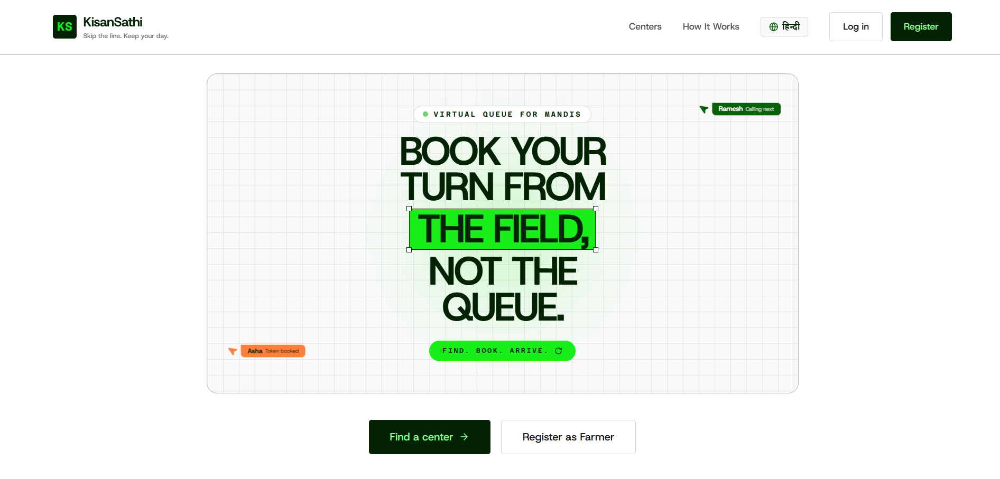<br>
  <b>🏠 Landing page</b><br>
  <sub>What KisanSathi does and how it works</sub>
</div>

<br>

<table>
  <tr>
    <td width="50%" align="center">
      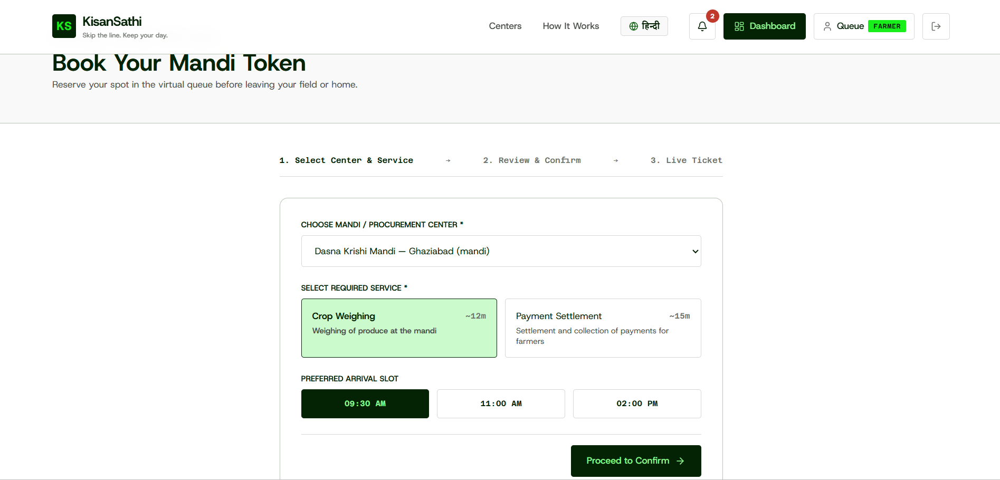<br>
      <b>🎟️ Book a token</b><br>
      <sub>Choose a center and a service</sub>
    </td>
    <td width="50%" align="center">
      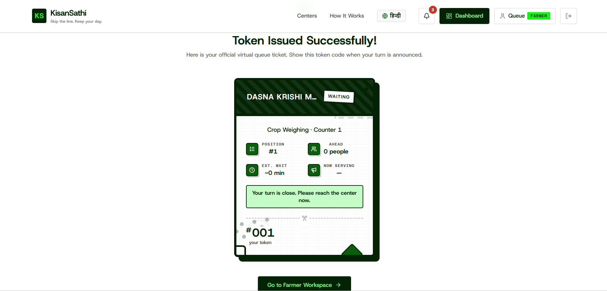<br>
      <b>✅ Token confirmation</b><br>
      <sub>Your token number, queue position and estimated wait</sub>
    </td>
  </tr>
</table>

<br>

<div align="center">
  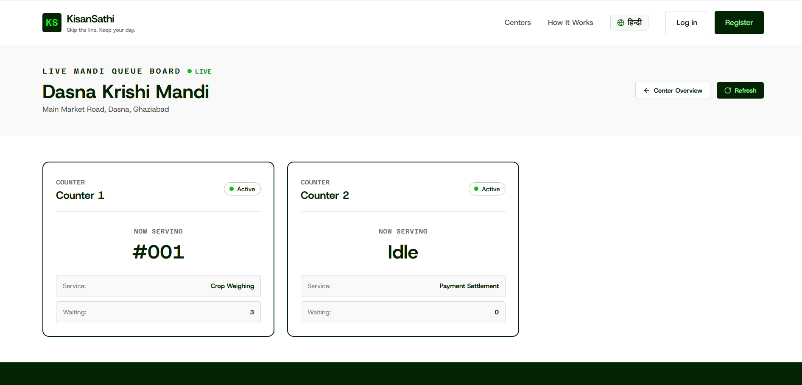<br>
  <b>📺 Live queue board</b><br>
  <sub>Public board showing who is being served now, updating in real time</sub>
</div>

<br>

<table>
  <tr>
    <td width="50%" align="center">
      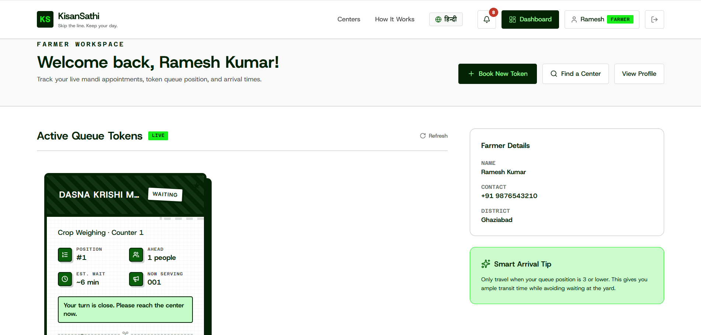<br>
      <b>🧑‍🌾 Farmer dashboard</b><br>
      <sub>Live position, estimated wait and arrival advice</sub>
    </td>
    <td width="50%" align="center">
      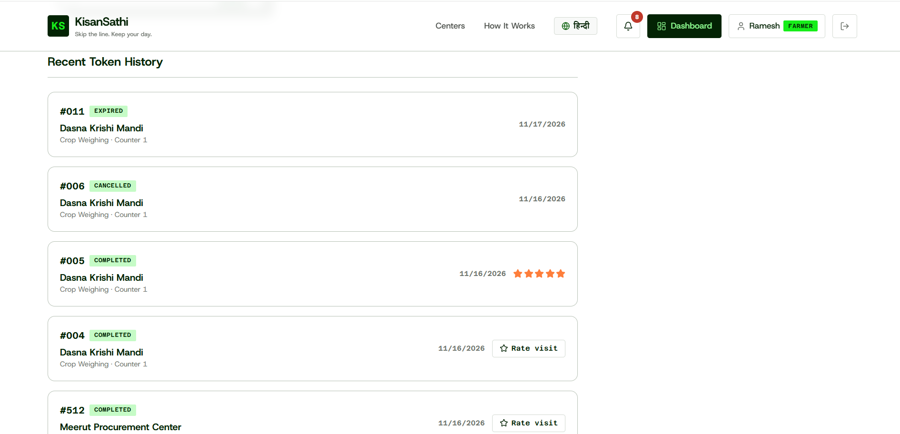<br>
      <b>🕘 Token history</b><br>
      <sub>Past visits with their status</sub>
    </td>
  </tr>
</table>

<br>

<div align="center">
  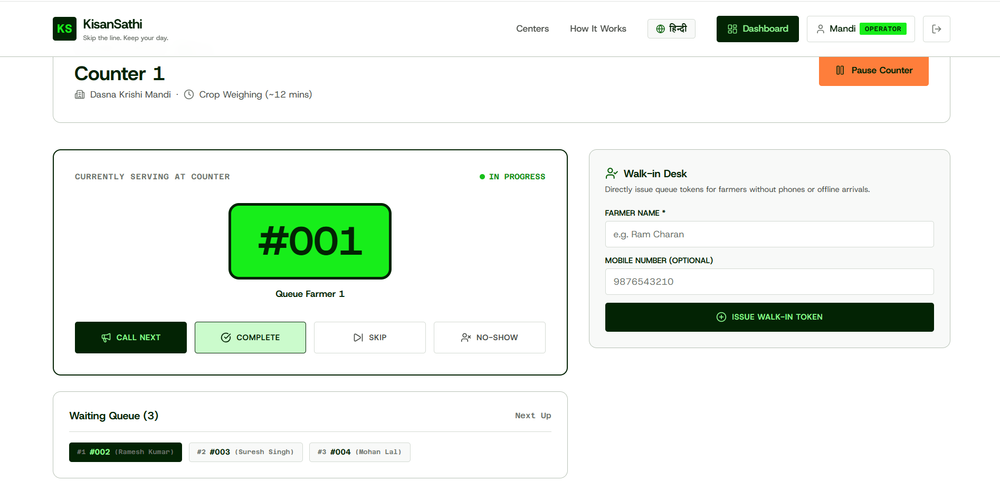<br>
  <b>🧑‍💼 Operator console</b><br>
  <sub>Call next, complete, skip, no-show and the walk-in desk</sub>
</div>

<br>

<div align="center">
  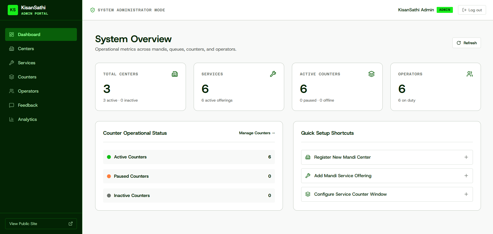<br>
  <b>🛡️ Admin dashboard</b><br>
  <sub>Overview of centers, counters and queues</sub>
</div>

<br>

<div align="center">
  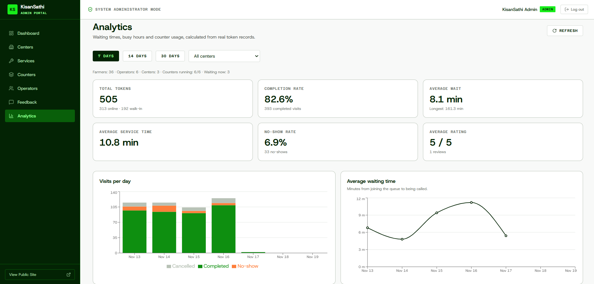<br>
  <b>📊 Admin analytics</b><br>
  <sub>Waiting times, peak hours and counter utilization, calculated from real token records</sub>
</div>

---

## ✨ Features

### 🧑‍🌾 Farmer

- 🔐 Register and log in securely
- 🏛️ Browse centers, see services, timings and running counters, and open the public live queue board
- 🎟️ Book a token for a service and get a unique token number
- ⏱️ Track queue position and estimated waiting time live, with advice on when to leave home
- ❌ Cancel a waiting token, and view current and past tokens
- 🔔 Get in-app notifications for booking, your turn, completion, skips, delays and queue progress
- ⭐ Rate a completed visit and leave a comment
- 🌐 Switch between English and Hindi

### 🧑‍💼 Operator

- 🖥️ A dedicated console for the operator's own counter
- 📣 Call the next token, then complete it, skip it, or mark a no-show
- 🚶 Register walk-in farmers who have no phone or account
- ⏸️ Pause and resume the counter
- 📋 See the waiting queue with estimated waiting times

### 🛡️ Administrator

- 🏛️ Manage centers, services, counters and operator assignments
- 📊 Analytics: completion rate, no-show rate, average waiting and service time, daily trend, peak hours and counter utilization
- ⭐ Farmer feedback with an average rating and star breakdown
- 🧾 Audit log of queue events and administrative actions

### 🚀 Distinctive features

| | Feature | How it works |
| :---: | --- | --- |
| ⏱️ | **Dynamic waiting time** | Wait = time left on the token being served + the service time of every token ahead. Service times learn from completed visits |
| ⚡ | **Real-time updates** | Socket.IO pushes queue changes to farmers, operators, admins and the public board without a refresh |
| 🧭 | **Center recommendation** | `GET /api/centers/compare` ranks the centers offering a service by estimated wait and free slots |
| ⚖️ | **Fair queue rules** | Skipped farmers go to the back of the line, a third skip becomes a no-show, and cancellations close up the queue |
| 🔀 | **Counter-aware distribution** | A new token goes to the active counter with the shortest line for that service |
| 🕒 | **Smart arrival guidance** | Farmers are told to arrive about 15 minutes before their estimated turn |
| 🚶 | **Walk-in registration** | Operators issue tokens for farmers without digital access, and they join the same queue |
| 🔔 | **In-app notifications** | Saved in the database and delivered live, in English and Hindi |
| 📊 | **Analytics from real data** | Every number comes from token records, with no hardcoded sample values |

---

## 🛠️ Tech stack

| Layer | Technology |
| --- | --- |
| 🎨 Frontend | React, Vite, Tailwind CSS, React Router, Axios |
| 📈 Charts | Recharts |
| ⚙️ Backend | Node.js, Express |
| 🗄️ Database | MongoDB with Mongoose |
| 🔐 Authentication | JWT and bcrypt |
| ⚡ Real time | Socket.IO |
| 🛡️ Validation and security | express-validator, helmet, CORS, role-based authorization |
| 🧰 Tools | VS Code, Git, GitHub, Thunder Client |

---

## 🏗️ Architecture

<div align="center">

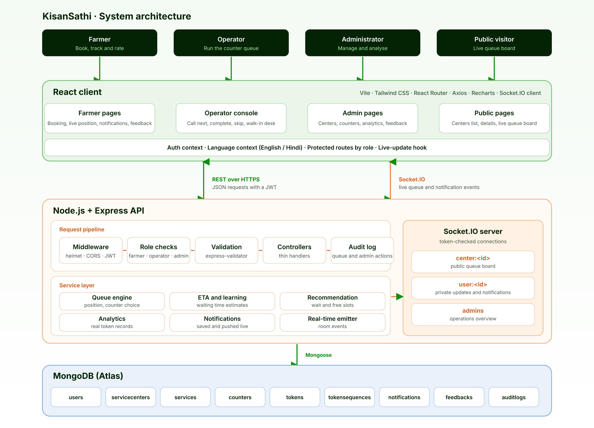

</div>

- 🖥️ **React client** talks to the server over **REST** (with a JWT) and listens for live events over **Socket.IO**.
- 🛡️ **Express API** passes every request through security, role checks, validation and audit logging before it reaches the controllers and the service layer.
- 🧠 The **service layer** holds the queue engine, waiting-time estimates, recommendations, analytics, notifications and real-time events.
- 🗄️ **MongoDB** stores users, centers, services, counters, tokens, notifications, feedback and the audit log.

### 🔄 Token life cycle

<div align="center">

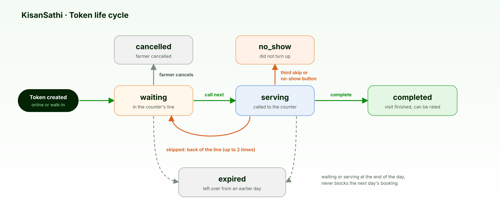

</div>

---

## 📁 Project structure

```
KisanSathi/
├── client/                     React app (Vite)
│   └── src/
│       ├── components/         Header, notification bell, token card, feedback form
│       ├── context/            Auth and language state
│       ├── hooks/              Live Socket.IO updates
│       ├── layouts/            Public, auth and admin layouts
│       ├── pages/              Farmer, operator, admin and public pages
│       ├── services/           Axios API client
│       └── utils/              Formatting and analytics helpers
├── server/                     Express API
│   └── src/
│       ├── config/             Database connection
│       ├── controllers/        Request handlers
│       ├── middleware/         Auth, validation, errors, audit
│       ├── models/             Mongoose schemas
│       ├── routes/             REST routes
│       ├── seeds/              Demo data scripts
│       ├── scripts/            Maintenance and check scripts
│       ├── services/           Queue, ETA, analytics, notifications, real time
│       ├── socket.js           Socket.IO setup
│       └── server.js           Entry point
├── docs/                       Architecture diagrams
└── screenshots/                Screenshots used in this README
```

**🗃️ Database models:** User, ServiceCenter, Service, Counter, Token, TokenSequence, Notification, Feedback and AuditLog.

---

## 🚀 Getting started

### 📋 Prerequisites

- Node.js 20.19+ (or 22.12+)
- Git
- A MongoDB database: a free MongoDB Atlas cluster, or a local MongoDB

### 1️⃣ Clone the project

```powershell
git clone <your-repository-url>
cd KisanSathi
```

### 2️⃣ Set up the server

```powershell
cd server
npm install
Copy-Item .env.example .env
```

Open `server/.env` and fill in the values:

| Variable | Description |
| --- | --- |
| `NODE_ENV` | `development` |
| `PORT` | API port, default `5000` |
| `MONGO_URI` | Your connection string, ending with the database name `kisansathi`. For Atlas: `mongodb+srv://<user>:<password>@<cluster>.mongodb.net/kisansathi?retryWrites=true&w=majority` |
| `CLIENT_URL` | Frontend address, default `http://localhost:5173` |
| `JWT_SECRET` | A long random string |
| `JWT_EXPIRES_IN` | Token lifetime, default `7d` |
| `ENFORCE_CENTER_HOURS` | `false` counts a center's full working day when working out free slots, which is easier for testing. `true` counts only the time left before closing |

Generate a `JWT_SECRET` with:

```powershell
node -e "console.log(require('crypto').randomBytes(48).toString('hex'))"
```

> ⚠️ Never commit your `.env` file. If you use Atlas, add your IP address under **Network Access**, and make sure every teammate uses the same database name.

### 3️⃣ Add demo data

Run these from the `server` folder:

```powershell
npm run seed
npm run seed:farmers
npm run seed:history
```

| Command | What it creates |
| --- | --- |
| `npm run seed` | The admin and operator accounts, 3 centers, their services and 6 counters |
| `npm run seed:farmers` | 5 demo farmers per counter, each with a waiting token for today |
| `npm run seed:history` | About a week of past tokens so the analytics charts have data |
| `npm run seed:history:clear` | Removes the demo history tokens |

All seed scripts are safe to run again.

### 4️⃣ Start the server

```powershell
npm run dev
```

The API runs at http://localhost:5000. Check http://localhost:5000/api/health.

### 5️⃣ Start the client

In a second terminal:

```powershell
cd client
npm install
npm run dev
```

Open http://localhost:5173 🎉

<details>
<summary><b>🧰 Useful scripts</b></summary>

<br>

| Folder | Command | Purpose |
| --- | --- | --- |
| server | `npm run dev` | Start with auto-restart |
| server | `npm start` | Start normally |
| server | `npm run check:queue` | Check the queue calculations with temporary tokens |
| server | `npm run check:socket` | Test a Socket.IO connection |
| server | `npm run listen:socket` | Print live events from the server |
| server | `npm run cleanup:stale:preview` | Show old tokens that would expire |
| server | `npm run cleanup:stale` | Expire old tokens from earlier days |
| client | `npm run dev` | Start the dev server |
| client | `npm run build` | Production build |
| client | `npm run lint` | Run ESLint |

</details>

---

## 🔑 Demo accounts

| Role | Login | Password |
| --- | --- | --- |
| 🛡️ Admin | `admin@kisansathi.in` | `admin123` |
| 🧑‍💼 Operator, Dasna Counter 1 (Crop Weighing) | `operator@kisansathi.in` | `operator123` |
| 🧑‍💼 Operator, Dasna Counter 2 (Payment Settlement) | `operator2@kisansathi.in` | `operator123` |
| 🧑‍💼 Operator, Hapur Counter 1 (Crop Weighing) | `operator3@kisansathi.in` | `operator123` |
| 🧑‍💼 Operator, Hapur Counter 2 (Procurement Registration) | `operator4@kisansathi.in` | `operator123` |
| 🧑‍💼 Operator, Meerut Counter 1 (Procurement Registration) | `operator5@kisansathi.in` | `operator123` |
| 🧑‍💼 Operator, Meerut Counter 2 (Quality Check) | `operator6@kisansathi.in` | `operator123` |
| 🧑‍🌾 Farmer | `farmer1@kisansathi.in` and onwards, created by `seed:farmers` | `farmer123` |

You can also register a new farmer from the app.

---

## 🎬 Demo walkthrough

> 💡 Use one normal window and one private window, because the login is stored in the browser.

1. 🧑‍🌾 **Farmer:** register or log in, open **Book token**, choose Dasna Krishi Mandi and Crop Weighing, and confirm. Note the token number, queue position and estimated wait.
2. 🧑‍💼 **Operator:** in the other window, log in as `operator@kisansathi.in` and click **Call Next**. The farmer's dashboard changes to "serving" at once, and the bell shows "It's your turn".
3. ✅ **Operator:** click **Complete**. The farmer gets a completion notification and can rate the visit.
4. 🚶 **Operator:** issue a walk-in token from the Walk-in Desk. It joins the same queue.
5. ⏭️ **Operator:** click **Skip** to see a token move to the back of the queue, and **Pause** the counter to see waiting farmers get a delay notice.
6. 🛡️ **Admin:** log in as `admin@kisansathi.in`. Open **Analytics** for waiting times and peak hours, **Feedback** for ratings, and **Counters** to change an operator.

---

## ⚙️ How the queue works

**⏱️ Waiting time.** For a waiting token: the time left on the token being served, plus the estimated service time of every token ahead of it. Each service starts with a configured duration and then learns from real completed visits using an exponentially weighted average, so the estimate improves as the system is used.

**🔀 Counter selection.** A new token goes to the active counter for that service with the fewest people in line. If a counter is set to inactive, its waiting tokens move to another active counter for the same service.

**⚖️ Fair rules.**

- Each center numbers its tokens from 1 every day.
- A farmer can hold only one active token at a time.
- Skipping sends a token to the back of the line. After two skips, a third skip marks it as a no-show.
- Cancelling or finishing a token moves everyone behind it up, and their estimates update.
- Tokens still waiting or being served from an earlier day are marked `expired`. They never block the next day's booking, and they stay in the history.

**🔒 Consistency.** Calling the next token, completing and skipping use conditional database updates, so two quick clicks or two tabs can never serve two tokens at once or count a visit twice.

**🕒 Arrival guidance.** Farmers are told to arrive about 15 minutes before their estimated turn. If the wait is shorter than that, they are told to come now.

All dates use Indian Standard Time.

---

## ⚡ Real-time updates

Clients connect with Socket.IO. A valid JWT is optional, and an invalid token is rejected.

| Room | Who joins | Events |
| --- | --- | --- |
| `center:<id>` | Anyone viewing a center's queue board | `queue:updated` |
| `user:<id>` | Each logged-in user | `token:updated`, `operator:queue-changed`, `notification:new` |
| `admins` | Administrators | `admin:queue-changed` |

The pages reload their data from the REST API when an event arrives, and also check every 30 seconds as a fallback.

---

## 🔌 API overview

All endpoints start with `/api`. Protected endpoints need the header `Authorization: Bearer <token>`. Errors always return `{ "success": false, "message": "..." }` with a suitable HTTP status.

<details>
<summary><b>🔐 Authentication</b></summary>

<br>

| Method | Endpoint | Access | Description |
| --- | --- | --- | --- |
| POST | `/auth/register` | Public | Register a farmer |
| POST | `/auth/login` | Public | Log in with email or phone |
| GET | `/auth/me` | Logged in | Current user |

</details>

<details>
<summary><b>🏛️ Centers and services</b></summary>

<br>

| Method | Endpoint | Access | Description |
| --- | --- | --- | --- |
| GET | `/centers` | Public | Active centers, with search and district filter |
| GET | `/centers/compare?service=&district=` | Public | Centers ranked by estimated wait and free slots |
| GET | `/centers/:id` | Public | Center details with services |
| GET | `/centers/admin/all` | Admin | All centers |
| POST, PUT, DELETE | `/centers`, `/centers/:id` | Admin | Create, update, delete |
| GET | `/services?center=` | Public | Active services |
| GET | `/services/admin/all` | Admin | All services |
| POST, PUT, DELETE | `/services`, `/services/:id` | Admin | Create, update, delete |

</details>

<details>
<summary><b>🧰 Counters and operator console</b></summary>

<br>

| Method | Endpoint | Access | Description |
| --- | --- | --- | --- |
| GET | `/counters?center=` | Public | Counters with the token being served and the waiting count |
| GET | `/counters/admin/all` | Admin | All counters with operators |
| GET | `/counters/operators` | Admin | Operators and their assigned counters |
| POST, PUT, DELETE | `/counters`, `/counters/:id` | Admin | Create, update, delete |
| PATCH | `/counters/:id/status` | Admin, Operator | Set active, paused or inactive (operators can only pause or resume) |
| GET | `/counters/mine` | Operator | The operator's counter |
| GET | `/counters/mine/queue` | Operator | Live queue of the operator's counter |
| POST | `/counters/mine/call-next` | Operator | Call the next waiting token |
| POST | `/counters/mine/complete` | Operator | Complete the token being served |
| POST | `/counters/mine/skip` | Operator | Skip it, or mark a no-show after two skips |
| POST | `/counters/mine/no-show` | Operator | Mark the token as a no-show |
| POST | `/counters/mine/walk-in` | Operator | Issue a walk-in token |

</details>

<details>
<summary><b>🎟️ Tokens</b></summary>

<br>

| Method | Endpoint | Access | Description |
| --- | --- | --- | --- |
| POST | `/tokens` | Farmer | Book a token for a center and service |
| GET | `/tokens/mine` | Farmer | Active token with queue info, and history |
| PATCH | `/tokens/:id/cancel` | Farmer | Cancel a waiting token |

</details>

<details>
<summary><b>🔔 Notifications and feedback</b></summary>

<br>

| Method | Endpoint | Access | Description |
| --- | --- | --- | --- |
| GET | `/notifications` | Logged in | Notifications with unread count |
| PATCH | `/notifications/:id/read` | Logged in | Mark one as read |
| PATCH | `/notifications/read-all` | Logged in | Mark all as read |
| POST | `/feedback` | Farmer | Rate a completed visit, once per visit |
| GET | `/feedback/mine` | Farmer | My feedback |
| GET | `/feedback` | Admin | All feedback with summary and filters |

</details>

<details>
<summary><b>📊 Administration</b></summary>

<br>

| Method | Endpoint | Access | Description |
| --- | --- | --- | --- |
| GET | `/analytics?from=&to=&center=` | Admin | Analytics calculated from token records |
| GET | `/audit-logs` | Admin | Audit log with category, action, center, date and page filters |
| GET | `/health` | Public | API and database status |

</details>

---

## 🧪 Testing

The APIs were tested manually with Thunder Client, and the queue calculations with the included check scripts.

| Area | What to check |
| --- | --- |
| 🔐 Auth | Register, log in, a wrong password gives 401, a farmer cannot open admin routes |
| 🎟️ Booking | A token is created, a second active token is refused, cancelling moves the queue up |
| 🧑‍💼 Operator | Call next, complete, skip, no-show, walk-in, pause and resume |
| ⚡ Real time | Operator actions appear on the farmer's screen without a refresh |
| 🔔 Notifications | Booked, called, completed, skipped, no-show, delay and progress messages |
| ⭐ Feedback | Only completed visits can be rated, and only once |
| 📊 Analytics | Numbers match the records in the database |
| 🧯 Edge cases | Tokens from earlier days expire and never block booking, double clicks never serve two tokens |

Run `npm run check:queue` in the `server` folder to verify the wait calculations.

---

## 👥 Team Members

Tanya Vaish, Teena Yadav, Shashwat Mishra, Saumya Tiwari

---

## 🤝 Team workflow

- Pull the latest code before you start: `git pull origin main`
- Work on your own branch: `git checkout -b feature/your-feature-name`
- Commit small changes with clear messages, then push your branch and open a pull request
- Never commit `.env` or any secret

---

## 🔮 Future scope

- 📱 SMS and WhatsApp notifications for farmers without smartphones
- 🌐 More languages beyond English and Hindi
- 🗺️ Maps and distance-based center recommendations
- 🧪 Automated tests and a deployment pipeline
- 📦 Mobile app packaging

---

<div align="center">

Developed for the B.Tech Full Stack Development mid-semester examination, KIET Group of Institutions.

**🌾 Less Waiting, More Growing.**

</div>